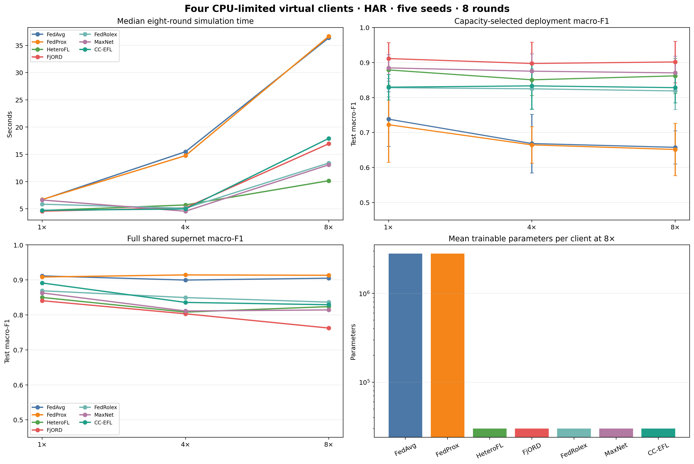
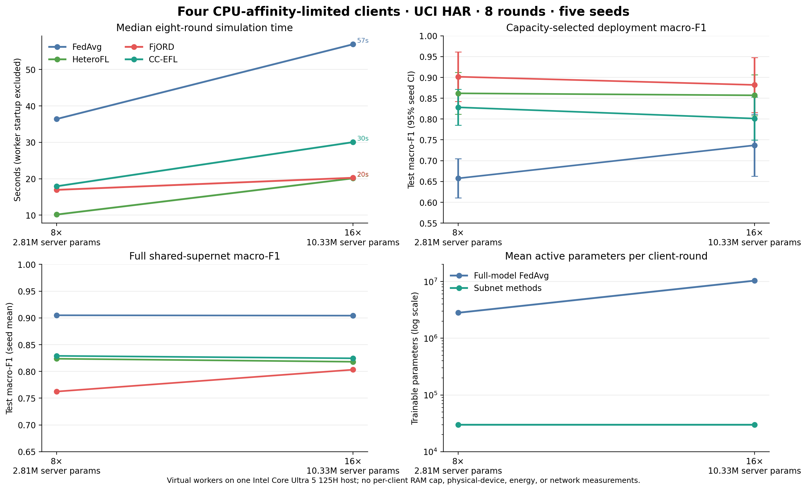

# Four-device CPU-split model-scaling benchmark

Raw output: .benchmarks/model_scaling/har_fourdevice_cpu_split_widthscale_1_4_8_8r_5seeds.json

## Setup

Dataset: UCI HAR, 7352 train / 1473 validation / 1474 test examples, six activity classes. The benchmark ran 3 server scales × 7 methods × 5 paired seeds (105 runs), eight rounds per run, with four clients.

Host: Intel(R) Core(TM) Ultra 5 125H; 14 physical cores, 18 logical processors, 15.6 GiB RAM; Windows; PyTorch 2.9.0+cpu; CUDA unavailable.

Client workers were affinity-limited to 1, 2, 4, and 8 logical processors (15 total); the coordinator used logical processors 15, 16, 17. Verified worker masks: [[0], [1, 2], [3, 4, 5, 6], [7, 8, 9, 10, 11, 12, 13, 14]].

Four device profiles use capacity tiers 0, 0, 1, and 2. At the 8× scale these are depth/width 1/24, 1/24, 2/48, and 5/72. FedAvg and FedProx train the full server model on every client; the subnet strategies train the assigned client model. The coordinator's held-out endpoint is selected by validation macro-F1.

The four worker processes were started once for the matrix; startup took 23.1 seconds and is reported separately. Per-run times below are medians across five seeds. The first cold run is retained in the raw output but does not set the median.

## Four virtual device specifications

| Device | CPU allocation | Logical processor IDs | Capacity tier | 8× client model | FP32 weights |
|---|---:|---|---:|---:|---:|
| device-1 (edge-1t) | 1 logical processor(s), 1 PyTorch thread(s) | 0 | 0 | depth 1, width 24, 13,686 parameters | 0.052 MiB |
| device-2 (low-2t) | 2 logical processor(s), 2 PyTorch thread(s) | 1, 2 | 0 | depth 1, width 24, 13,686 parameters | 0.052 MiB |
| device-3 (mid-4t) | 4 logical processor(s), 4 PyTorch thread(s) | 3, 4, 5, 6 | 1 | depth 2, width 48, 29,814 parameters | 0.114 MiB |
| device-4 (high-8t) | 8 logical processor(s), 8 PyTorch thread(s) | 7, 8, 9, 10, 11, 12, 13, 14 | 2 | depth 5, width 72, 62,646 parameters | 0.239 MiB |

These are four virtual CPU-limited client processes on one host, not four physical machines. CPU affinity limits where a worker may run; it does not reserve physical cores against other Windows processes. The benchmark does not enforce per-device RAM limits.

## Median end-to-end simulation time

Seconds for one eight-round run, including local training, server aggregation, validation, and final evaluation. The shared worker-pool startup is excluded above. Times are not real-device or network latency.

| Method | 1× / 96 wide | 4× / 384 wide | 8× / 768 wide |
|---|---:|---:|---:|
| FedAvg | 6.7 s | 15.5 s | 36.4 s |
| FedProx | 6.7 s | 14.8 s | 36.7 s |
| HeteroFL | 4.7 s | 5.7 s | 10.2 s |
| FjORD | 4.6 s | 5.2 s | 16.9 s |
| FedRolex | 5.8 s | 5.1 s | 13.4 s |
| MaxNet | 6.6 s | 4.6 s | 13.1 s |
| CC-EFL | 4.7 s | 5.0 s | 17.9 s |

## Capacity-selected client deployment scores

Cells show test macro-F1 with an unadjusted 95% seed-level t interval, followed by accuracy. These metrics average the validation-selected models available under the participating client capacity tiers.

| Method | 1× | 4× | 8× |
|---|---:|---:|---:|
| FedAvg | 0.738 (0.660–0.816); acc 0.756 | 0.668 (0.585–0.752); acc 0.695 | 0.658 (0.610–0.705); acc 0.695 |
| FedProx | 0.722 (0.615–0.829); acc 0.751 | 0.665 (0.612–0.717); acc 0.691 | 0.651 (0.577–0.726); acc 0.689 |
| HeteroFL | 0.879 (0.835–0.922); acc 0.887 | 0.851 (0.806–0.895); acc 0.864 | 0.862 (0.812–0.912); acc 0.874 |
| FjORD | 0.911 (0.866–0.957); acc 0.916 | 0.897 (0.836–0.958); acc 0.905 | 0.902 (0.842–0.961); acc 0.908 |
| FedRolex | 0.828 (0.802–0.854); acc 0.848 | 0.825 (0.768–0.882); acc 0.849 | 0.819 (0.765–0.872); acc 0.840 |
| MaxNet | 0.885 (0.847–0.923); acc 0.892 | 0.875 (0.825–0.925); acc 0.885 | 0.870 (0.823–0.918); acc 0.881 |
| CC-EFL | 0.830 (0.793–0.866); acc 0.849 | 0.833 (0.766–0.900); acc 0.853 | 0.828 (0.785–0.871); acc 0.849 |

## Full shared supernet scores and client cost

Full-model scores are test macro-F1 / accuracy. Active parameters are the mean number trained per client per round; coordinate coverage is the fraction of server parameter coordinates touched during the eight rounds.

| Scale | Method | Full-model F1 / accuracy | Active parameters / client | Coordinate coverage |
|---:|---|---:|---:|---:|
| 1× | FedAvg | 0.911 / 0.914 | 92,742 | 100.0% |
| 1× | FedProx | 0.908 / 0.911 | 92,742 | 100.0% |
| 1× | HeteroFL | 0.850 / 0.865 | 29,958 | 67.5% |
| 1× | FjORD | 0.841 / 0.857 | 29,958 | 67.5% |
| 1× | FedRolex | 0.869 / 0.881 | 29,958 | 78.2% |
| 1× | MaxNet | 0.863 / 0.875 | 29,958 | 67.5% |
| 1× | CC-EFL | 0.891 / 0.899 | 29,958 | 78.2% |
| 4× | FedAvg | 0.900 / 0.904 | 813,318 | 100.0% |
| 4× | FedProx | 0.914 / 0.917 | 813,318 | 100.0% |
| 4× | HeteroFL | 0.808 / 0.829 | 29,958 | 7.7% |
| 4× | FjORD | 0.803 / 0.825 | 29,958 | 7.7% |
| 4× | FedRolex | 0.850 / 0.862 | 29,958 | 8.9% |
| 4× | MaxNet | 0.811 / 0.830 | 29,958 | 7.7% |
| 4× | CC-EFL | 0.836 / 0.849 | 29,958 | 8.9% |
| 8× | FedAvg | 0.905 / 0.907 | 2,806,278 | 100.0% |
| 8× | FedProx | 0.913 / 0.915 | 2,806,278 | 100.0% |
| 8× | HeteroFL | 0.824 / 0.834 | 29,958 | 2.2% |
| 8× | FjORD | 0.762 / 0.793 | 29,958 | 2.2% |
| 8× | FedRolex | 0.836 / 0.844 | 29,958 | 2.6% |
| 8× | MaxNet | 0.814 / 0.836 | 29,958 | 2.2% |
| 8× | CC-EFL | 0.829 / 0.848 | 29,958 | 2.6% |

## Per-device local training time at 8×

Mean seconds per local round across methods' five seeds; this is local model construction, data-loader setup, and client training, excluding aggregation and inter-process serialization.

| Device | Full FedAvg local seconds / round | CC-EFL local seconds / round | CC-EFL trainable parameters |
|---|---:|---:|---:|
| device-1 (edge-1t) | 2.59 s | 0.15 s | 13,686 |
| device-2 (low-2t) | 2.47 s | 0.16 s | 13,686 |
| device-3 (mid-4t) | 2.03 s | 0.26 s | 29,814 |
| device-4 (high-8t) | 1.31 s | 0.39 s | 62,646 |

## Interpretation and limits

At 8×, the full server MLP has 2,806,278 parameters, while CC-EFL clients train an average of 29,958 parameters each. The average active client parameter and estimated FLOP reductions versus full FedAvg are both 98.9%.

At 8×, CC-EFL's capacity-selected test macro-F1 is 0.828 (0.785–0.871), versus 0.658 for capacity-selected FedAvg. Its full shared-model macro-F1 is 0.829, versus 0.905 for full FedAvg. CC-EFL touches only 2.6% of the enlarged supernet coordinates in eight rounds, so these data support small-client participation but do not show that the entire expanded supernet has converged.

The largest model here is a 2.81-million-parameter MLP, not an LLM-scale model. Weight sizes and FLOPs are estimates. No physical-device peak RAM, energy, real network time, or per-device memory limits were measured. Reported intervals are exploratory and are not corrected across all method-by-scale comparisons.

## 16× server-scale follow-up

A separate paired five-seed, eight-round follow-up extends the shared HAR MLP to width 1,536 (10,331,142 parameters; 39.41 MiB of FP32 weights) while retaining the same four client CPU allocations and fixed client subnet sizes. This adds 20 runs for FedAvg, HeteroFL, FjORD, and CC-EFL; it is not a full repeat of the original seven-method matrix. The four clients still train the 13,686 / 13,686 / 29,814 / 62,646-parameter tiers shown above.

| Method | Median time / 8 rounds | Capacity-selected test macro-F1 (95% CI) / accuracy | Full-supernet test macro-F1 / accuracy | Coordinate coverage |
|---|---:|---:|---:|---:|
| FedAvg | 56.9 s | 0.737 (0.662–0.811) / 0.753 | 0.904 / 0.907 | 100.0% |
| HeteroFL | 20.1 s | 0.857 (0.808–0.906) / 0.869 | 0.818 / 0.837 | 0.61% |
| FjORD | 20.3 s | 0.882 (0.816–0.948) / 0.890 | 0.803 / 0.830 | 0.61% |
| CC-EFL | 30.0 s | 0.801 (0.750–0.853) / 0.828 | 0.825 / 0.845 | 0.70% |

All three heterogeneous methods average 29,958 active parameters per client-round, 99.71% fewer than full-model FedAvg; these are trainable parameter counts, not per-device measured RAM. Paired capacity-selected macro-F1 differences versus capacity-sliced FedAvg are +0.120 (95% CI +0.070 to +0.170) for HeteroFL, +0.145 (+0.087 to +0.203) for FjORD, and +0.064 (+0.016 to +0.112) for CC-EFL. CC-EFL's full-supernet score is 0.825 versus 0.904 for full-model FedAvg after only 0.70% coordinate coverage. This extends the CPU-only simulation to a 10.33M-parameter MLP, but the larger model remains sparsely updated and no physical-device, memory-cap, energy, or real-network claim follows.

Raw follow-up output: `.benchmarks/model_scaling/har_fourdevice_cpu_split_widthscale_16_8r_5seeds.json`.

## Fresh 8× confirmation: ten paired seeds

To check whether the 8× result depended on the original five seeds, we ran a
fresh paired block with seeds 6–15 for FedAvg, HeteroFL, and FjORD (30 runs;
eight rounds each). The same split, four fixed client profiles, CPU affinity,
and 2,806,278-parameter server model were used. This confirms the three-method
comparison only; it is not a rerun of the seven-method matrix. Confidence
intervals are unadjusted 95% seed-level Student-t intervals.

| Method | Median time / 8 rounds | Capacity-selected client macro-F1 (95% CI) / accuracy | Full shared-model macro-F1 / accuracy | Active parameters per client-round | Coordinates covered |
|---|---:|---:|---:|---:|---:|
| FedAvg | 30.52 s | 0.660 (0.602–0.717) / 0.689 | 0.908 / 0.911 | 2,806,278 | 100.0% |
| HeteroFL | 7.94 s | 0.848 (0.807–0.888) / 0.866 | 0.813 / 0.834 | 29,958 | 2.23% |
| FjORD | 9.42 s | 0.905 (0.885–0.926) / 0.909 | 0.811 / 0.832 | 29,958 | 2.23% |

The paired FjORD-minus-capacity-sliced-FedAvg deployment macro-F1 difference
is +0.245 (95% CI +0.188 to +0.303). The median per-seed FedAvg/FjORD
simulation-time ratio is 2.97. Comparing the FjORD client-deployment score
with the *full-model* FedAvg score gives a descriptive paired difference of
−0.003 (95% CI −0.021 to +0.015). This cross-endpoint interval is not a
pre-registered equivalence or non-inferiority test. Meanwhile, the full
FjORD supernet trails full FedAvg by 0.098 macro-F1 (95% CI −0.188 to
−0.008). Together these results show high-quality small client deployments,
not convergence of the 2.81M-parameter shared model.

### Per-device result and local time

The following FjORD scores are each device tier's validation-selected,
capacity-feasible deployment; intervals use the same ten paired seeds. The
1-thread and 2-thread profiles intentionally share the same model capacity,
so they receive the same selected model and test score. Local seconds are the
mean client model-construction, data-loader, and training time per round; they
exclude aggregation and inter-process serialization. The FedAvg local-time
column is for full-model training on each affinity-limited worker.

| Virtual client profile | CPU threads | Maximum FjORD active parameters / round | Mean selected deployment parameters | FjORD test macro-F1 (95% CI) / accuracy | Mean local seconds / round FjORD / FedAvg |
|---|---:|---:|---:|---:|---:|
| edge-1t | 1 | 13,686 | 13,686 | 0.889 (0.855–0.923) / 0.896 | 0.048 / 1.874 |
| low-2t | 2 | 13,686 | 13,686 | 0.889 (0.855–0.923) / 0.896 | 0.058 / 2.035 |
| mid-4t | 4 | 29,814 | 18,539 | 0.919 (0.904–0.933) / 0.920 | 0.135 / 1.751 |
| high-8t | 8 | 62,646 | 23,744 | 0.924 (0.915–0.934) / 0.925 | 0.198 / 1.004 |

This is the clearest evidence that the smallest worker can contribute: its
selected model averages 13,686 parameters (0.052 MiB of FP32 weights), and its
test macro-F1 is 0.889. The average selected FjORD deployment across all four
profiles is 17,414 parameters (0.066 MiB); the mean active training size is
29,958. These are parameter-derived weight sizes, not measured peak memory.

Raw runs: `.benchmarks/model_scaling/har_fourdevice_8x_confirmation_10newseeds.json`.
Regenerate the endpoint and device summaries with
`python -m non_medical_benchmark.analysis.summarize_cpu_split_confirmation --input .benchmarks/model_scaling/har_fourdevice_8x_confirmation_10newseeds.json --output .benchmarks/model_scaling/har_fourdevice_8x_confirmation_10newseeds_analysis.json`.
The plot is `../results_graphs/four_device_8x_confirmation_10seeds.png`.

## Second-workload check: Digits

We also ran five fresh paired seeds (6–10) for FedAvg, HeteroFL, and FjORD
on the 8× Digits MLP using the same four CPU budgets. The server model has
830,474 parameters; the heterogeneous methods average 4,282 active parameters
per client-round (99.48% fewer). Capacity-selected macro-F1 is 0.290
(0.245–0.334) for FedAvg, 0.759 (0.701–0.817) for HeteroFL, and 0.810
(0.743–0.877) for FjORD. Their median eight-round times are 11.98, 5.85, and
5.64 seconds. Full-model FedAvg scores 0.964 macro-F1, while the FjORD full
supernet scores 0.623; the excellent HAR client/full comparison does not
generalize to this endpoint or workload. Treat Digits as a small, five-seed
cross-workload check, not as evidence of non-inferiority or general large-model
convergence.

Raw runs: `.benchmarks/model_scaling/digits_fourdevice_8x_confirmation_5seeds.json`.
The adult/bank-marketing extension was stopped after its first Adult FedAvg
run took 104.4 seconds; no complete aggregate was produced and it is not
included in the results or paper claims.

| Virtual client profile | CPU threads | Capacity tier / max parameters | FjORD mean selected parameters | FjORD test macro-F1 (95% CI) / accuracy | Mean local seconds / round |
|---|---:|---:|---:|---:|---:|
| edge-1t | 1 | 1×16 / 1,242 | 1,242 | 0.725 (0.625–0.825) / 0.765 | 0.092 |
| low-2t | 2 | 1×16 / 1,242 | 1,242 | 0.725 (0.625–0.825) / 0.765 | 0.142 |
| mid-4t | 4 | 2×32 / 3,594 | 3,594 | 0.884 (0.819–0.949) / 0.892 | 0.189 |
| high-8t | 8 | 4×48 / 11,050 | 4,128 | 0.905 (0.884–0.927) / 0.906 | 0.469 |

The Digits profile table uses five seeds and unadjusted per-tier intervals. As
with HAR, two different endpoints must remain separate: the client models are
useful, but FjORD's complete 830,474-parameter supernet averages only 0.623
macro-F1.
