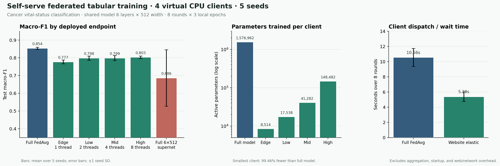

# Self-serve website method: four-client benchmark

Raw results: [`.benchmarks/tabular_web_method/project_vital_status_source_clients_6x512_5seeds.json`](../.benchmarks/tabular_web_method/project_vital_status_source_clients_6x512_5seeds.json)

Runner: [`run_website_method_benchmark.py`](run_website_method_benchmark.py)

Reproduce the primary run from the repository root:

```powershell
python -m non_medical_benchmark.run_website_method_benchmark `
  --dataset project_vital_status --partition source_clients `
  --seeds 1,2,3,4,5 --rounds 8 --epochs 3 `
  --max-depth 6 --max-width 512 `
  --output .benchmarks/tabular_web_method/project_vital_status_source_clients_6x512_5seeds.json
```

This evaluates the tabular model builder and resource planner added to the
website. It compares full-model FedAvg with the website's budget-conditioned
elastic-prefix method. The selected primary configuration uses a 6-layer,
512-wide shared MLP for the cancer vital-status task.

## Experimental setup

- Target: `vital_status` (alive/dead), from the project's four existing CSV
  client partitions.
- 66 original input columns are transformed to a 512-dimensional shared input
  representation; the task has two output classes.
- Data: 2,451 participant training rows; 817 host setup rows, split into 653
  reference rows and 164 host-validation rows; 820 independent test rows.
- Both methods use four workers, eight federated rounds, three local epochs,
  five seeds (1–5), and the same source partitions. The profile-to-partition
  assignment is shuffled by seed.
- Full-model FedAvg trains all 1,576,962 parameters on every client. The website
  method trains the depth/width prefix assigned by the resource planner,
  returns only those coordinates, and aggregates covered coordinates by local
  sample count.
- The website method reports each client's final capacity-sized model on the
  same independent test set. Its `full_global_test_metrics` separately scores
  the complete 6×512 model.

## Host and four virtual client profiles

The run used one Intel Core Ultra 5 125H workstation (14 cores, 18 logical
processors, 15.61 GiB RAM), Windows 11, CPU-only PyTorch 2.9.0. The four workers
were separate processes with CPU affinity masks verified as IDs 0, 1–2, 3–6,
and 7–14. These are simulated device tiers on one workstation, not four
physical machines. CPU affinity does not reserve physical cores from other
processes. RAM values below are inputs to the resource planner, not enforced
process limits.

| Virtual profile | CPU threads / logical IDs | RAM planner input | Assigned client model | Active parameters | FP32 weights sent | Test macro-F1 (mean ± seed SD) |
|---|---|---:|---:|---:|---:|---:|
| Edge | 1 / `0` | 0.5 GB | 2×16 | 8,514 | 34,056 B | 0.777 ± 0.011 |
| Low | 2 / `1–2` | 2 GB | 2×32 | 17,538 | 70,152 B | 0.798 ± 0.012 |
| Mid | 4 / `3–6` | 4 GB | 3×64 | 41,282 | 165,128 B | 0.799 ± 0.014 |
| High | 8 / `7–14` | 8 GB | 6×128 | 148,482 | 593,928 B | 0.803 ± 0.007 |

The full 6×512 model has 1,576,962 parameters and 6,307,848 FP32 weight bytes.
The smallest participant trains 99.46% fewer parameters than this full model;
the largest participant trains 90.59% fewer. These are parameter-derived
weight sizes, not measured peak RAM.

## Results

| Method / endpoint | Test accuracy (mean ± SD) | Test macro-F1 (mean ± SD) | 8-round client dispatch/wait time (mean ± SD) |
|---|---:|---:|---:|
| Full-model FedAvg, same full model on all clients | 0.868 ± 0.005 | 0.854 ± 0.006 | 10.56 ± 1.18 s |
| Website method, mean of the four capacity-sized client deployments | 0.811 ± 0.011 | 0.794 ± 0.009 | 5.39 ± 0.62 s |
| Website method, complete 6×512 global model | 0.700 ± 0.159 | 0.686 ± 0.159 | — |

The client-round dispatch/wait sum was 49% lower for the website method. It
times sending each round's local work to the four worker processes and waiting
for all four results across eight rounds. It excludes server aggregation,
validation, worker startup, website/API work, encryption, and network transfer.
The wider harness elapsed time, including worker startup, aggregation, and
evaluation but excluding the website and network, averaged 26.61 s for the
website method and 29.75 s for full-model FedAvg; this measurement is noisy and
does not establish a 49% end-to-end speedup.

Across five seeds, the capacity-sized client deployments averaged macro-F1
0.794 (SD 0.009); full-model FedAvg averaged 0.854 (SD 0.006). The paired
descriptive difference (full FedAvg minus mean client deployment) was 0.059
(95% seed-level t interval 0.048–0.070). The full 6×512 model had only 9.42%
coordinate coverage after eight rounds and highly variable results across
seeds (macro-F1 0.443, 0.816, 0.808, 0.610, 0.754). Therefore the deployment
scores must not be presented as convergence of the complete 6×512 global
model. They answer a different question: how well the models that fit each
client's budget perform.

Confidence intervals are exploratory, based on five seed-level runs, and are
not adjusted for multiple comparisons. The full-model FedAvg reference and the
mean of differently sized deployments are distinct endpoints; the difference
is descriptive, not a non-inferiority claim.

### Exploratory shared-width check

We also ran the same five seeds with a 6×128 maximum model. This smaller
configuration reached 100% coordinate coverage, but mean client-deployment
macro-F1 was 0.746 (SD 0.039) versus 0.837 (SD 0.003) for full-model FedAvg.
Its client-round dispatch/wait time was 4.90 s versus 5.12 s. The edge profile
was especially variable. This is a configuration check, not part of the
primary 6×512 result; it illustrates that full coordinate coverage alone did
not give the best small-client quality or measured round time here. Raw output:
`.benchmarks/tabular_web_method/project_vital_status_source_clients_6x128_5seeds.json`.

## Interpretation for the capstone

This is evidence that CPU-constrained participants can train compact local
submodels and contribute their covered parameters to a larger shared model.
The best result is the trade-off: about 49% less measured client-round
dispatch/wait time, client deployment macro-F1 around 0.79, and a 0.059
macro-F1 gap from the full-model reference. The current prefix schedule leaves
most coordinates of a 6×512 global model untouched, so the capstone must show
both the useful client deployments and the weak full-supernet endpoint.

This experiment supports a heterogeneous tabular FL systems demonstration. It
does not show LLM-scale training, phone-class hardware, physical RAM limits,
energy savings, real network latency, secure aggregation, or deployment in a
hospital. The host setup CSV is uploaded and its validation rows remain at the
coordinator; use public or synthetic setup data for the capstone demo.


